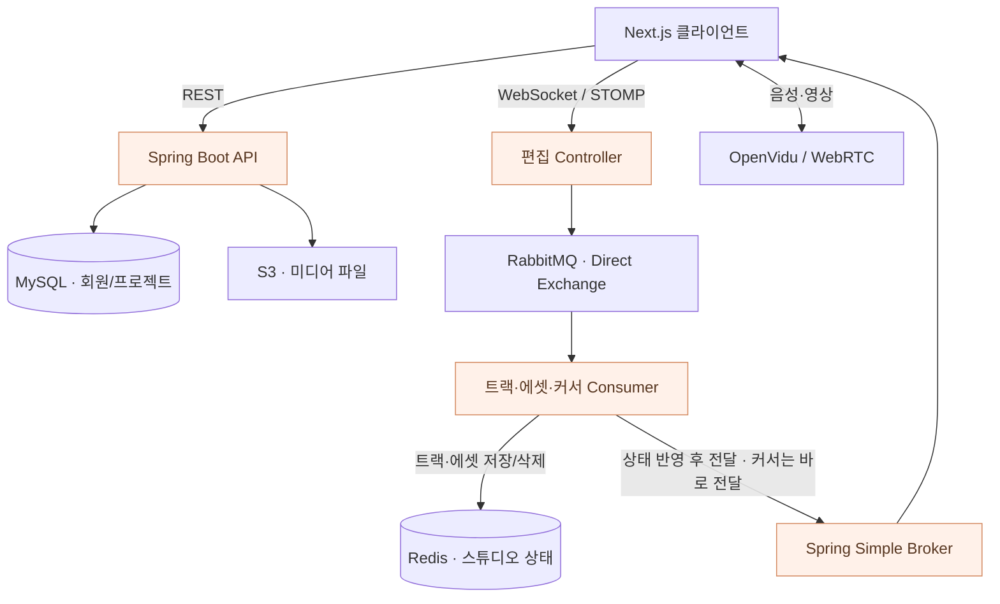

<h1 align="center">🎙️ DubDub</h1>
<p align="center"><b>함께 녹음하고, 같은 타임라인에서 편집하는 웹 더빙 스튜디오</b></p>
<p align="center">
  
  
  
  
  
</p>

## 어떤 서비스인가요?

설치 없이 웹에서 대본을 보고, 역할을 나눠 녹음하고, 타임라인을 함께 편집하는 **실시간 더빙 서비스**입니다. 음성·영상으로 의견을 주고받으면서 오디오 트랙·에셋·커서와 재생 상태를 공유합니다.

**기간** 2025.01.06–02.21 · **팀** 6명 · **백엔드** 2명

- **함께 작업하는 스튜디오** — 화상·음성 연결, 참여자 관리, 재생·녹음 상태 공유
- **공동 편집** — 트랙·오디오 에셋·커서 변경 전달과 스튜디오 상태 저장
- **프로젝트 운영** — 인증, 캐스팅 모집, 미디어 파일 업로드

## 이현정의 담당 영역

- **실시간 편집 서버** — WebSocket/STOMP, RabbitMQ 이벤트 분기와 Redis 상태 저장을 연결했습니다.
- **미디어·인증 연동** — OpenVidu 세션·토큰, 인증과 실시간 연결 관리를 담당했습니다.
- **배포·장애 추적** — Jenkins·Docker 실행 환경, 인증서와 Nginx HTTPS/WSS 연결 문제를 구간별로 확인했습니다.
- **스크럼 운영** — 협업 도구 가이드·기술 세미나를 마련하고, 막힌 이유와 필요한 도움을 기준으로 역할·일정을 조정했습니다.

## 편집 데이터와 음성·영상의 경로

**편집 이벤트는 STOMP·RabbitMQ로, 음성·영상은 OpenVidu·WebRTC로 전달합니다.** Redis는 편집 중인 스튜디오의 상태를 저장합니다.



### RabbitMQ: 이벤트별 처리 경로 분리

`studio.exchange`에 트랙·에셋·커서용 큐를 각각 연결했습니다. Controller가 이벤트 종류에 맞는 routing key로 발행하고, Consumer가 상태 변경과 클라이언트 전달을 담당합니다.

| 이벤트 | Routing key | Consumer의 처리 |
| --- | --- | --- |
| 트랙 파일·녹음자 | `studio.track` | Redis 상태 반영 후 전달 |
| 오디오 에셋 | `studio.asset` | 저장·삭제 반영 후 전달 |
| 커서 | `studio.cursor` | 별도 상태 저장 없이 전달 |

재생·녹음 상태(`playback`)는 STOMP에서 직접 전달합니다. 큐 분리는 이벤트별 처리 책임을 나눈 것이며, 서버·브로커 자원까지 독립시킨 구조는 아닙니다.

[Exchange·Queue 설정](server/dubdub/src/main/java/com/ssafy/dubdub/wss/config/RabbitMQConfig.java) · [이벤트 발행](server/dubdub/src/main/java/com/ssafy/dubdub/wss/controller/WebSocketController.java) · [소비·저장·전달](server/dubdub/src/main/java/com/ssafy/dubdub/wss/service/StudioMessageHandler.java)

### Redis: 스튜디오별 편집 상태 저장

오디오 에셋·트랙 파일·녹음자 상태를 `studio:{sessionId}:{type}:{id}` 형태의 키로 구분하고, 참여자 세션도 Redis 저장소로 관리합니다. 스튜디오 진입·조회 시 현재 상태를 읽고, 편집 이벤트가 도착하면 해당 객체를 저장하거나 삭제합니다.

`StudioStoreService` 아래에 메모리·Redis 구현체를 분리했으며, Redis 구현체가 기본(`@Primary`)으로 선택됩니다.

[상태 저장 인터페이스](server/dubdub/src/main/java/com/ssafy/dubdub/wss/service/StudioStoreService.java) · [Redis 구현](server/dubdub/src/main/java/com/ssafy/dubdub/wss/service/StudioRedisStoreServiceImpl.java) · [참여자 관리](server/dubdub/src/main/java/com/ssafy/dubdub/wss/service/StudioSessionService.java)

### 현재 구현의 경계

이 README의 코드 설명은 기본 브랜치 `master`를 기준으로 합니다.

- Redis 저장은 객체 단위 `SET`과 패턴 키 조회를 사용합니다. 만료 편집권·Lua 버전 검사·Sorted Set 타임라인은 이 브랜치에 포함되어 있지 않습니다.
- 메시지 처리 중 예외를 로그로 남기는 경로가 있어, 큐를 도입했다는 사실만으로 재시도·무손실 전달이 보장되지는 않습니다.
- STOMP 전달은 Spring Simple Broker를 사용합니다. Redis를 사용하더라도 여러 서버의 WebSocket 구독이 자동으로 공유되지는 않습니다.

## 저장소 구조

```text
client/                    # Next.js · React · TypeScript
├── src/app/               # 프로젝트·로비·스튜디오 화면
└── public/                # 이미지·정적 파일
server/
├── dubdub/                # Spring Boot 애플리케이션
│   └── src/main/java/com/ssafy/dubdub/
│       ├── wss/           # 편집 이벤트·Redis 상태·세션 관리
│       ├── controller/    # REST API
│       └── config/        # 애플리케이션 구성
├── Dockerfile
└── docker-compose.yml
exec/                      # 포팅 문서·시연 산출물
```

## 개발 환경과 실행

**Backend** Java 17 · Spring Boot 3.4.1 · Spring Security · JPA · QueryDSL  
**Realtime** WebSocket/STOMP · RabbitMQ · Redis · OpenVidu 2.31 · WebRTC  
**Client** Next.js 15 · React 19 · TypeScript · Zustand  
**Operations** MySQL · AWS S3 · Docker · Jenkins · Nginx

MySQL·Redis·RabbitMQ·OpenVidu 접속 정보와 OAuth·S3·TLS 설정을 준비합니다. 빌드·배포 구성은 [포팅 매뉴얼](exec/porting_manual.md)에 정리되어 있습니다.

```bash
# 백엔드 빌드 — 저장소 루트 기준
cd server/dubdub
bash ./gradlew bootJar
```

```bash
# 프론트엔드 — 별도 터미널, 저장소 루트 기준
cd client
npm ci
npm run dev
```

프론트엔드의 API·WebSocket·OpenVidu 주소와 백엔드 환경 설정을 맞춘 뒤 실행합니다. 미디어 연결 확인에는 OpenVidu 서버와 브라우저의 마이크·카메라 접근 환경이 필요합니다.
